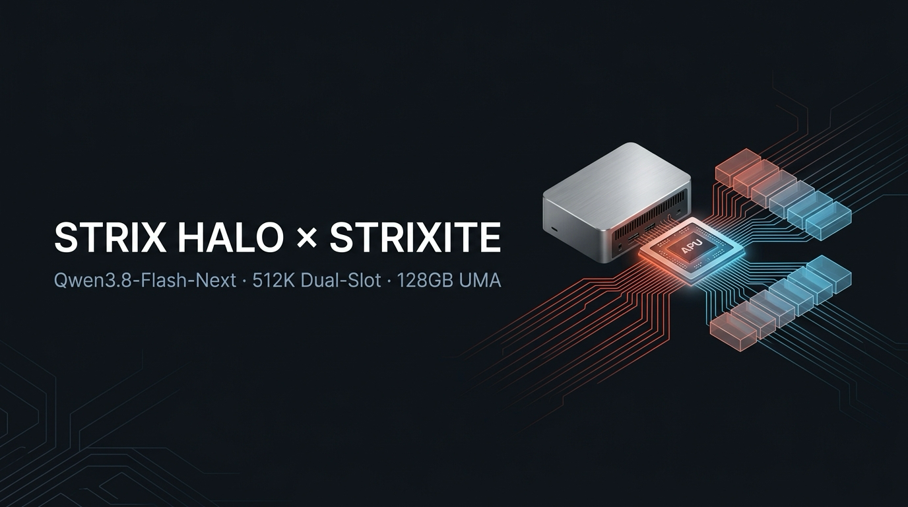

<p align="center">
  
</p>

# Strix Halo × Strixite: Qwen 3.8 Flash Next (512k Dual-Slot) Deployment & Tuning

Reproducible Linux host tuning, rootless Podman Quadlet recipe, verification scripts, and live long-context benchmarks for serving **Qwen3.8-Flash-Next** (`524,288` context × `2` concurrent slots) via **[shawnshekari/strixite](https://github.com/shawnshekari/strixite)** on a 128 GB **AMD Strix Halo** (`Ryzen AI MAX+ 395` / `Radeon 8060S`, `gfx1151`).

> **Scope & Credits:** This repo contains deployment configs, host tuning, and benchmark tooling. The inference engine belongs to [shawnshekari/strixite](https://github.com/shawnshekari/strixite) (AGPL-3.0), and the converted weights are [wemoh/Qwen3.8-Flash-Next-strixw](https://huggingface.co/wemoh/Qwen3.8-Flash-Next-strixw) (Qwen Community License 1.0).

---

## Verified Hardware & Software Stack

| Component | Tested Environment |
|---|---|
| **Machine** | Framework Desktop (AMD Ryzen AI Max 300 Series, BIOS `03.05`) |
| **APU / GPU** | AMD Ryzen AI MAX+ 395 w/ Radeon 8060S (`gfx1151`, 16C/32T) |
| **Memory** | 128 GB LPDDR5X (`125.08 GiB` Linux `MemTotal`, `512 MiB` BIOS UMA carveout) |
| **Storage** | 256 GB NVMe (`WD PC SN740 SDDPNQD-256G-2006`, `232 GiB` ext4 `/`) |
| **OS / Kernel** | Ubuntu Linux `7.0.0-44-generic` |
| **Engine** | `ghcr.io/shawnshekari/strixite:v0.7.1` (Podman `5.7.0` rootless Quadlet) |
| **Model** | `Qwen3.8-Flash-Next` (`65.9 GiB` `weights.strixw`, `48.3 GiB` `ngram.table`, `0.84 GiB` `vision.strixw`) |

---

## Measured Results (Post-Tuning)

### 1. Long-Context Speed & Needle Recall (`temperature=0`, `thinking=off`, 50% depth)
| Prompt Tokens | Context Region | Prefill Speed | Decode Speed | Wall Time | Needle Recall |
|---:|---|---:|---:|---:|---|
| 75,888 | Native (<262k) | **1,699 t/s** (`44.67 s`) | **49.2 t/s** (`140` tok) | 47.49 s | **PASS** (`ALPHA-7492-FALCON`) |
| 314,315 | YaRN 2× (>262k) | **1,566 t/s** (`200.64 s`) | **50.2 t/s** (`177` tok) | 204.15 s | **PASS** (`BRAVO-3819-OSPREY`) |
| 460,436 | YaRN 2× (~450k) | **1,512 t/s** (`304.56 s`) | **45.7 t/s** (`161` tok) | 308.16 s | **PASS** (`CHARLIE-9054-KESTREL`) |

### 2. Short Context, 460k Cache Resume & 2-Slot Concurrency
| Test Case | Prompt / Cached Tokens | Key Timing / Speed | Outcome |
|---|---:|---|---|
| **Short decode** | 28 / 0 | **74.5 t/s** decode (`256` tok in `3.42 s`) | **PASS** (`3.64 s` wall) |
| **8k prefill** | 7,811 / 0 | **1,794 t/s** prefill (`4.35 s`) | **PASS** (`4.47 s` wall) |
| **460k RAM cache resume** | 460,619 / 460,429 | **96 ms** load (`7,939 MB`), **74.6 t/s** decode | **PASS** (`0.77 s` wall, `CHARLIE-9054-KESTREL`) |
| **2-slot concurrent prefill** | 35,743 / 0 | **1,751 t/s** prefill (`20.41 s`), `16.7 t/s` decode (`17` tok) | **PASS** (`21.37 s` wall) |
| **2-slot concurrent decode** | 35 / 0 | `4.23 s` prefill (queued behind `12.1 s` state export) | **PASS** (`29.78 s` wall, `256` tok) |
| **Context-limit guard** | 542,729 / — | Exceeded `524,288` cap | **PASS** (clean HTTP `400`) |

### 3. Before vs. After Tuning Impact
| Metric | Before Tuning | After Tuning / Post-Suite |
|---|---|---|
| **65.9 GiB weight load time** | `44.6 s` | **`32.5 s`** (-27%) |
| **8k prefill / 256-tok decode** | `1,689 t/s` / `69.8 t/s` | **`1,794 t/s`** / **`74.5 t/s`** |
| **`MemAvailable` (startup / post-suite)** | `24.3 GiB` (margin `12 GiB`, 2nd-slot warning) | **`26.5 GiB` startup** (margin `5 GiB`, **0 warnings**) / **`9.8 GiB` post-suite** |
| **RAM prompt cache (`strix_prompt_cache_ram_bytes`)** | `0 B` | **`22.1 GiB`** (`4` entries, **`0`** room refusals) |
| **Disk prompt cache (`strix_prompt_cache_bytes`)** | `0 B` (`56.7 GiB` cap warning) | **`6.4 GiB`** (`3` entries evicted, `72 GiB` cap, **0** warnings) |
| **Swap used (`/swap.img`, `8.0 GiB`)** | `180 KiB` | **`96 KiB`** (zero swap growth under 460k+ load) |
| **MTP acceptance (`strix_mtp_acceptance_rate`)** | — | **`75.0%`** (`588 / 784` drafted tokens) |
| **Idle temps & GPU power (post-suite)** | `41.0 °C` / `10.0 W` | GPU **`45.0 °C`** (`10.2 W`), CPU **`46.9 °C`**, NVMe **`46.9 °C`** |

---

## Why Each Fix Matters

1. **BIOS VRAM Carveout = Minimum (`512 MiB`) + GTT/TTM Limits**
   - Large static BIOS carveouts lock away RAM that the OS and prompt cache need. Keeping BIOS UMA at `512 MiB` and setting `amdgpu.gttsize=131072 ttm.pages_limit=32505856` exposes `~124–125 GiB` dynamically via GTT (`84.7 GiB` GPU buffers for 2×512k slots).
2. **`amd_iommu=off` (or `iommu=pt`)**
   - Default Ubuntu boots with `iommu: Default domain type: Translated`, routing every GPU/GTT DMA access through AMD-Vi page tables. Setting `amd_iommu=off` cut weight load time from `44.6 s` to **`32.5 s`** and boosted prefill/decode throughput.
   - *Trade-off:* `amd_iommu=off` disables the Ryzen AI NPU (`amdxdna`) and VFIO device passthrough. Use `--iommu pt` (`iommu=pt`) if you need either of those.
3. **RAM Prompt-Cache Margin (`--prompt-cache-ram-margin-gib 5`)**
   - After loading (`84.7 GiB` GPU + `3.0 GiB` n-gram cache), `MemAvailable` is `~26.5 GiB` on a dedicated host. One full 512k slot's paged K/V takes `8.2 GiB`. Setting the margin to `12 GiB` left too little headroom to hold a deep conversation state (`5–8.3 GiB`) in RAM alongside active slots; lowering to `5 GiB` (and stopping idle co-located CPU services) eliminates the startup memory warning and enabled **96 ms / 0.77 s** 460k-token resumes.
4. **Disk Prompt-Cache Sizing on 256 GB SSDs**
   - `strix-infer` takes `115 GiB`, leaving `~89 GiB` free on a `232 GiB` ext4 `/` partition. With the default `32 GiB` free-disk floor, the `128 GiB` cap cannot be reached (`56.7 GiB` max). Setting `--prompt-cache-disk-free-gib 16 --prompt-cache-gib 72` removes the warning and still holds ~7–9 full-depth 512k conversations across restarts. (Full `128 GiB` + `32 GiB` floor requires a 500 GB+ NVMe or a second M.2 drive.)
5. **Linux VM & Dirty Writeback (`configs/99-strix-halo.conf`)**
   - `vm.swappiness = 1`: prevents Ubuntu's default `60` from swapping active server pages to `/swap.img` under unified-memory pressure.
   - `vm.vfs_cache_pressure = 50`: biases toward retaining file/page cache for the `48.3 GiB` SSD-streamed `ngram.table`.
   - `vm.dirty_background_bytes = 67108864` / `vm.dirty_bytes = 536870912`: replaces `10%`/`20%` RAM ratios (`12.5–25 GiB`) with 64 MiB / 512 MiB byte caps to prevent multi-GB NVMe writeback stalls during prompt-cache checkpoints.
6. **CPU EPP `performance` (`configs/cpu-epp-performance.service`)**
   - Keeps GPU DPM at `auto` (~10 W idle), while eliminating CPU ramp latency for tokenization, HTTP/JSON, prompt-cache delta exports, and PLE n-gram SSD prefetching.
7. **Rootless Podman Quadlet + `--network=host` (`configs/strixite.container`)**
   - Replaces rootless Podman's `pasta` userspace TCP forwarding (`-p 5300:5300`) with `Network=host` (zero proxy overhead, real client IPs in logs), sets `TimeoutStopSec=90` so shutdowns flush the prompt cache cleanly, and auto-starts on boot via `loginctl enable-linger`.

---

## Quick Start

### 1. Download & Verify the Weights
```bash
sudo mkdir -p /mnt/models && sudo chown "$USER:$USER" /mnt/models
hf download wemoh/Qwen3.8-Flash-Next-strixw --local-dir /mnt/models/strix-infer
cd /mnt/models/strix-infer && sha256sum -c sha256.txt
```

### 2. Tune the Host & Reboot
```bash
chmod +x scripts/*.sh scripts/benchmark.py
./scripts/setup-host.sh --iommu off   # or --iommu pt if you need NPU/VFIO
sudo reboot
```

### 3. Deploy the Podman Quadlet Service
```bash
./scripts/deploy-quadlet.sh
```
Check startup progress (~32–45 s for `65.9 GiB` weight load):
```bash
journalctl --user -u strixite.service -f
```

### 4. Verify & Benchmark
```bash
./scripts/verify.sh
./scripts/benchmark.py --url http://127.0.0.1:5300/v1 --quick
```
Full 64k / 256k / 450k NIAH + 450k RAM cache resume + 2-slot concurrency suite (~8–10 min):
```bash
./scripts/benchmark.py --url http://127.0.0.1:5300/v1
```

---

## Repository Layout
```text
.
├── assets/
│   └── banner.png                      # Hero banner artwork
├── configs/
│   ├── 99-strix-halo.conf              # /etc/sysctl.d/99-strix-halo.conf
│   ├── cpu-epp-performance.service     # systemd unit setting amd-pstate EPP=performance
│   └── strixite.container              # Rootless Podman Quadlet unit (--network=host)
├── scripts/
│   ├── setup-host.sh                   # Configures sysctl, CPU EPP, linger, and GRUB
│   ├── deploy-quadlet.sh               # Installs & starts strixite.service via Quadlet
│   ├── verify.sh                       # Checks kernel, GTT, sysctl, EPP, socket, /metrics
│   └── benchmark.py                    # Zero-dependency speed, NIAH, cache, concurrency bench
├── LICENSE                             # MIT (configs & scripts)
└── README.md
```

---

## Rollback
* **Kernel boot args:** Restore your timestamped backup `/etc/default/grub.bak-*` and run `sudo update-grub && sudo reboot`.
* **Host tuning:** Remove `/etc/sysctl.d/99-strix-halo.conf` (`sudo sysctl --system`) and disable `cpu-epp-performance.service` (`sudo systemctl disable --now cpu-epp-performance.service`).
* **Service:** `systemctl --user disable --now strixite.service` and remove `~/.config/containers/systemd/strixite.container`.
